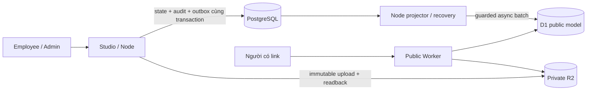

# HTML Share Platform

Nhân viên đăng nhập để upload HTML/CSS/JavaScript hoặc ZIP website tĩnh, xuất bản và chia sẻ link HTTPS. Người có link public không cần đăng nhập. Nội dung upload là **untrusted code**: chỉ chạy trong trình duyệt có sandbox, không chạy trên server hoặc origin quản trị.

## Trạng thái

Pilot A' đã được owner nghiệm thu; Epic #31 và các issue triển khai đã đóng. PR #19 đã merge ngày 26/10/2026, đóng review #10 **cho pilot/lab hiện tại**. Đây không phải phê duyệt production. [Trạng thái và bằng chứng](docs/PROJECT_STATUS.md).

## Kiến trúc A' đang dùng

- **Studio/Node + PostgreSQL:** Clerk, allowlist/RBAC, ownership, upload/readback, trạng thái site/version, link và audit. PostgreSQL là nguồn sự thật duy nhất.
- **Outbox + Node projector/recovery:** sự kiện cùng transaction PostgreSQL, chiếu bất đồng bộ một chiều sang D1 bằng batch có guard phiên bản. Handler không dual-write D1.
- **Một public Worker + D1/R2 private:** đọc trạng thái published và manifest rồi trả đúng asset. Không API quản trị, preview Worker, Clerk secret hoặc callback VM.
- **Preview riêng trên Node/VM:** grant 128-bit, scope actor/site/version, TTL 3 phút; iframe và mọi HTML vẫn có sandbox không `allow-same-origin`.



## Link thực tế của pilot

| Vai trò / URL | Hành vi hiện tại |
| --- | --- |
| Studio `https://studio-lab.ods.vn` | Quản trị qua Node/PostgreSQL |
| `https://hsp-pilot.odsusercontent.workers.dev/<share-code>` | 308 sang đường có dấu `/` cuối |
| `/<share-code>/` trên public Worker | Trả trực tiếp `index.html` từ R2 với HTTP CSP sandbox |
| `/<share-code>/<asset-path>` | Chỉ trả asset đúng manifest của bản đang published |
| Preview `p-<site-id>--<grant>.lab-space-ods.cfvn.cloud` | Node/VM kiểm grant, actor/policy/version/expiry cho từng asset |

Share code là 10 ký tự base62 phân biệt hoa/thường; khác site ID 32 hex và version UUID. Worker hiện **chưa có shell OG do nền tảng sinh, chưa có route `/raw/<id>`**. Đây là phần đã thống nhất để làm sau. [Contract link](docs/SHARE_LINKS.md).

`view-lab.ods.vn` và dịch vụ lab cũ được owner giữ cho link test riêng; chúng không phải fallback của A'. Không dọn chúng hoặc nhập dữ liệu cũ vào read model theo hướng dẫn này.

## Giới hạn và bảo mật

ZIP tối đa 20 MiB, giải nén 100 MiB, 500 file, depth 12; kiểm traversal/symlink/bomb/định dạng/path trùng trước publish. Version/asset bất biến; Node xác minh size/SHA/ETag trước commit. Public Worker kiểm published và manifest ở mỗi request, tối đa một SELECT primary, R2 GET/HEAD theo pin; HTML có sandbox, no-store, nosniff, no-referrer.

Revoke/unpublish chặn request public mới **sau khi chiếu**. Healthy revoke p95≤60 giây; cảnh báo khi revoke pending>60 giây. Không bảo đảm chặn trong 60 giây lúc projector/REST dừng và không thu hồi byte đã tải trong tab. Native D1/R2 bindings có khả năng ghi ở nền tảng; public code chỉ đọc được bảo đảm bằng code/test/review, không phải IAM read-only.

## Phát triển và vận hành

Node 22+ và npm. Bộ test local dùng fixture trống; không cần credential pilot:

```sh
npm ci
npm run lint
npm run typecheck
npm test
npm run build:public-worker
npm run build
python scripts/check_docs.py
```

[Phát triển và test local/CI](docs/DEVELOPMENT.md) phân biệt fixture MinIO với R2 pilot. [Runbook Node pilot](docs/PILOT_APRIME_NODE_ROLLOUT.md) dành cho hệ thống đã khởi tạo; không chạy lại setup/migration hay dùng Compose local để cập nhật VM.

## Đọc tiếp

- [Bản đồ tài liệu và thứ tự ưu tiên](docs/DOCUMENTATION_MAP.md)
- [Kiến trúc](docs/ARCHITECTURE.md) · [Kế hoạch hiện hành](PLAN.md) · [ADR-0006](docs/adr/0006-postgresql-source-of-truth-d1-public-read-model.md)
- [Handoff agent](docs/AI_HANDOFF.md) · [AGENTS](AGENTS.md) · [Workflow](docs/WORKFLOW.md)
- [Quản trị Node](docs/NODE_POSTGRES_ADMIN.md) · [Projector/token policy](docs/PUBLIC_PROJECTOR.md) · [Recovery](docs/READ_MODEL_RECOVERY.md)
- [Public Worker](docs/PUBLIC_READ_MODEL_WORKER.md) · [Read-model contract](docs/D1_PUBLIC_READ_MODEL.md)
- [Nghiệm thu pilot](docs/PILOT_APRIME_ACCEPTANCE.md) · [Authority](docs/PILOT_APRIME_AUTHORITY.md)
- [Lịch sử trước khi tổng hợp tài liệu](docs/history/README.md)
