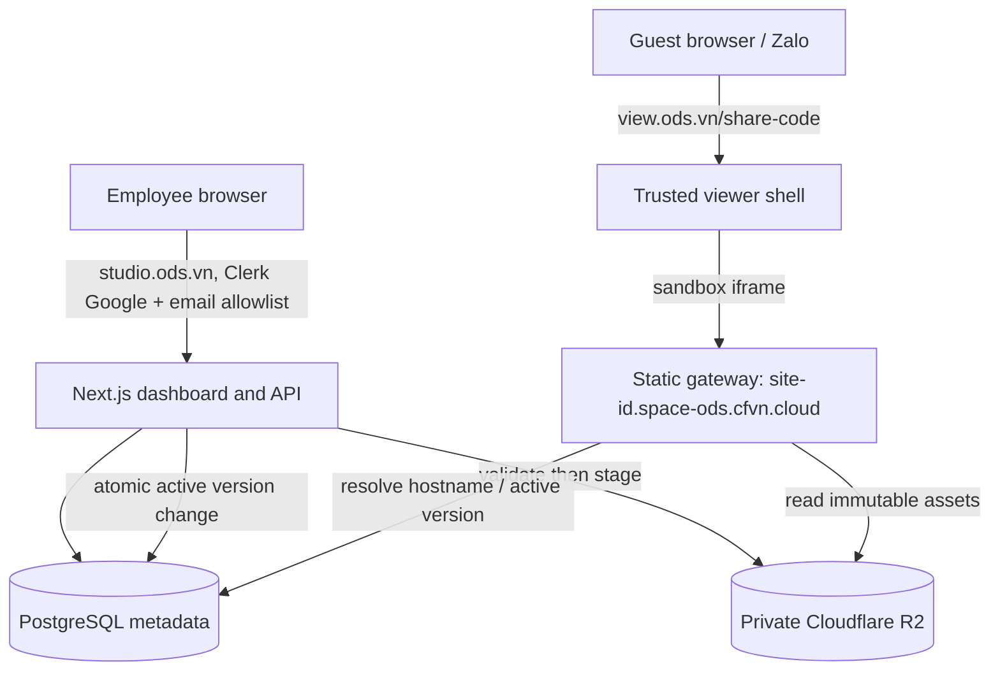

# Kiến trúc và luồng dữ liệu (đề xuất)

Trạng thái: **Proposed** cho release/security; domain và thiết kế link **Accepted** theo [ADR-0004](adr/0004-domains-and-share-codes.md). Triển khai vẫn theo [ADR-0001](adr/0001-public-site-origin-isolation.md).

Implementation lab #13 đã có Clerk server auth/RBAC, gateway hostname/manifest, trusted viewer và private preview theo [ADR-0003](adr/0003-server-rbac-and-preview-capabilities.md). [Validation](validation/2026-10-09-auth-origin-gates.md) ghi code/Chrome local đã kiểm; [nghiệm thu VM](validation/2026-10-09-lab-domain-tls.md) bổ sung owner-confirmed Admin/Employee login và TLS content lab, không coi R2/domain viewer/mobile gates đạt; không đổi trạng thái Proposed thành production approval.

[Cập nhật 2026-10-22](LAB_HANDOFF.md): web VM `share-dc7560ea1c34`, DB0001/0002/0003, short viewer đã chạy; gateway giữ security-417c50d trong web-only cutover. Studio/viewer public HTTPS qua Cloudflare, content direct VM/nginx; owner mở443 và xác nhận khách ngoài tải iframe/dùng thử OK. Agent kiểm runtime/DB/headers chỉ đọc. R2/real-session security/cookie/mobile/release review còn riêng; các snapshot tunnel-only/chưa cutover là lịch sử.

## Ranh giới UI có thể thay thế

Theo [ADR-0002](adr/0002-replaceable-studio-ui.md), Studio dùng component presentation → workflow hook → typed HTTP adapter → `/api/*` Route Handlers → server services. Components/features không import database, storage hoặc server auth; ESLint enforce ranh giới này. Vì vậy có thể thay giao diện hoặc client mà không viết lại ingest/publish/storage. Backend vẫn cùng container Next.js ở lab; tách process/service về sau là quyết định deployment riêng, giữ session/CSRF và origin isolation.

## Data model dự kiến

- `users`: id, external_identity, email, role, status, created_at; identity từ Clerk Google nhưng quyền từ DB.
- `auth_allowlist`: email đã chuẩn hóa, role, status, updated_at; operator quản lý server-side, không JWT/UI metadata.
- `sites`: id (unguessable), owner_id, display_name, status, active_version_id, created_at, updated_at.
- `site_versions`: id, site_id, storage_prefix, uploaded_by, manifest_hash, asset_manifest (path/type/size/SHA-256), created_at, published_at.
- `preview_grants`: token_hash, site_id, immutable version_id, actor_id, expires_at; token 128-bit, TTL 3 phút, không lưu raw grant.
- `site_share_links`: code exact-case 10 base62 PRIMARY KEY, site_id, created_at, revoked_at; một mã active/site qua partial UNIQUE index. Migration 0003 và Node backfill additive; giữ mã revoked làm tombstone, không sửa host ID/storage/pointers. PR #15 triển khai [lifecycle/API](SHARE_LINKS.md) theo ADR-0004.
- `audit_events`: actor_id, action, target_type, target_id, timestamp, request_id.

Site ID xuất hiện trong hostname public; dùng giá trị random đủ entropy (ít nhất 128 bits). ID không đại diện cho quyền truy cập bí mật.

## Branded link và cách sinh hostname

Bảng domain production/lab ở ADR-0004. PR #15 resolve viewer bằng share code active + site published, trả canonical URL từ server; code/test local đã pass và web lab VM đã cutover ngày22/10. Content giữ host ID32hex/HTTPS/sandbox; viewer không giữ alias ID dài. [Lab handoff](LAB_HANDOFF.md) là baseline vận hành hiện tại.

- `studio.ods.vn`: Next.js dashboard, Clerk Google Development (P2), API Route Handlers `/api/*` chung container. Danh sách email được phép, role Employee/Admin phải kiểm tra **trên server**. PostgreSQL và gateway kết nối bằng Docker internal network, chưa cần `api.ods.vn`.
- Link gửi khách: `https://view.ods.vn/<share-code>` trả **trusted viewer shell** (title, mô tả Open Graph và iframe responsive), tuyệt đối không trả raw HTML đã upload. Viewer không dùng cookie/session quản trị, không nhúng HTML untrusted vào DOM hoặc SSR. Redirect `studio.ods.vn/view/<share-code>` về viewer khi cấu hình host riêng; alias host ID 32 hex trả 404. Lookup có budget mỗi process trước DB, no-store/no-referrer; edge per-IP/multiple replicas cần gate riêng.
- Origin HTML: `https://<site-id>.space-ods.cfvn.cloud/`. Site ID do server sinh ngẫu nhiên >=128 bit, chỉ chứa ký tự DNS hợp lệ; reserve các hostname đã sử dụng và tên hệ thống (`www`, `mail`, `api`, `admin`, v.v.). Gateway đọc HTTP Host, so khớp chính xác ID hợp lệ trong database và trạng thái `published`, từ chối host không có site (404), chỉ lấy assets từ R2 **private**. Tạo site **không cần API tạo thêm DNS record**.
- P4 dùng wildcard riêng `*.space-ods.cfvn.cloud` và `*.lab-space-ods.cfvn.cloud` trỏ tới reverse proxy/static gateway; named DNS records cụ thể có ưu tiên trước wildcard nên các website đã có record riêng vẫn resolve tới đích cũ. Tuy vậy wildcard bắt mọi hostname chưa có record; phải kiểm kê DNS/Workers routes/hostname của zone trước thay đổi, không ghi đè record đang tồn tại, không cấp mã site trùng tên reserved, thử regression trên website hiện hữu. Wildcard route chỉ serve site ID hợp lệ.
- TLS phải có SAN đúng wildcard từng môi trường; `*.cfvn.cloud` không bao phủ các content host này. Lab dùng nginx + Let's Encrypt DNS-01/ACME-DNS đã kiểm; production cần certificate/gia hạn riêng. Cloudflare proxy/Origin CA không còn là yêu cầu bắt buộc. Cấu hình HTTPS public port rỗng ở web/gateway, không lộ port nội bộ 4100 vào URL.
- **Cookie boundary:** lab/production content và website khác có thể cùng parent `cfvn.cloud`. Nếu JS untrusted chạy trực tiếp ở `a.space-ods.cfvn.cloud`, nó có thể đặt cookie `Domain=cfvn.cloud` ảnh hưởng các site khác trong domain này; wildcard DNS **không** giải quyết vấn đề cookie. Do đó gateway phải gửi HTTP header `Content-Security-Policy: sandbox allow-scripts` cho **mọi phản hồi HTML** upload (không chỉ `index.html`), **kể cả khi truy cập URL trực tiếp**, không cấp `allow-same-origin` hoặc khả năng thoát sandbox. Cấm upload/serve trực tiếp các định dạng có khả năng chạy script ngoài HTML đã sandbox (ví dụ SVG, XHTML, XML chủ động, PDF nhúng); chỉ thêm khi có threat review và response policy chặt chẽ. Viewer cũng dùng iframe `sandbox="allow-scripts"`, CSP `frame-src https://*.space-ods.cfvn.cloud`; gateway giới hạn `frame-ancestors https://view.ods.vn` và không cấp cookie/session quản trị. Kiểm chứng bằng browser rằng HTML trực tiếp/iframe không đặt/đọc được cookie hoặc storage trong parent domain và sibling/cross-environment hosts; trước khi chứng minh, **không mở public gateway**.
- CSP sandbox tạo opaque origin; localStorage/service workers, ES modules, fetch/CORS, form, popup, top navigation và một số SPA/Web APIs sẽ bị hạn chế. P4 phải kiểm thử các gói HTML đại diện trên Chrome/Safari/Zalo trước khi cam kết hỗ trợ. Không gỡ `sandbox`/thêm `allow-same-origin` chỉ để sửa demo; thay đổi đó cần phương án cô lập khác (ví dụ domain chuyên dụng hoặc PSL được kiểm chứng) và security review riêng.
- Share code và host ID độc lập; đổi mã viewer không chặn direct URL. Candidate tắt alias host ID ở root và /view; migration/backfill không phục hồi link đã revoked. Unpublish/delete chặn request mới, không thu hồi tab đã tải. Rollback không được bật lại alias bypass revocation; xem SHARE_LINKS.
- Preview chưa published phải dùng grant phạm vi hẹp, TTL ngắn, không lộ token qua logs/referrer. Link published có thể được mọi người có URL truy cập; mã ID không thay thế xác thực nội dung bí mật.

## Upload & publish

1. Xác thực Employee và rate limit. Stream upload tới vùng tạm với byte cap.
2. Đối với file HTML: chuẩn hóa tên thành `index.html`. Đối với ZIP: chỉ hỗ trợ site có `index.html` tại root; từ chối absolute path, `..`, symlink, hardlink, encrypted archive, path trùng sau chuẩn hóa, file vượt size/count/depth và content không thuộc allowlist.
3. Kiểm tra tất cả entry trên stream trước khi publish, kiểm tra file extension/MIME, lập manifest; loại bỏ file server-executable. Không thực thi hoặc render HTML trên API host.
4. Ghi tệp vào storage key bất biến theo `siteId/versionId/path`. Chỉ sau khi upload thành công toàn bộ mới lưu version hoàn tất và đổi `active_version_id` trong transaction.
5. Nếu upload thất bại: không đổi phiên bản active; dọn staging bằng cleanup job.
6. Preview trên origin publish của phiên bản staging (grant ngắn hạn để không public trước publish), nhúng trong trusted viewer shell. Không inject nội dung vào dashboard DOM.

### Local upload hardening (#9)

Local MVP áp byte cap 22 MiB cho toàn multipart body trước parser (file quota 20 MiB), không tin Content-Length. PUT preflight owner trước body ingest và kiểm tra lại dưới row lock trước ZIP/storage. Reserve immutable version/prefix, ghi toàn bộ assets, rồi active pointer/audit trong cùng transaction. Lỗi trước COMMIT rollback và cleanup exact new keys, retry tối đa 3 lần; COMMIT response không xác định giữ objects và trả 503 để client refresh. Cleanup failure/process crash cần operator reconciliation; durable orphan lifecycle còn P5/P6. Chi tiết và bằng chứng trong [validation #9](validation/2026-10-09-upload-hardening.md); không thay origin policy hoặc auth production.

### Auth và preview lab (#8/#10)

API xác minh session bằng Clerk SDK trực tiếp, strip spoof headers, không qua Next proxy để giữ stream cap #9. Session active online + verified primary Google email + allowlist/user active trên server; Employee owner-only, Admin mọi site với audit actual actor. Mutation CSRF exact Origin/Host; transaction recheck/khóa policy/user để revoke/downgrade không vượt authorization race. Local demo chỉ exact loopback, Clerk không fallback.

Gateway hostname public `<id>.space-ods.cfvn.cloud` và preview `<id>--<grant>.space-ods.cfvn.cloud`, cùng root assets. Preview là bearer capability scope actor/site/version; DB hash, TTL 3 phút, recheck policy/ownership khi serve. Viewer không Clerk/provider/cookie; preview shell authenticated trên Studio nhưng iframe không nhận session. Mọi asset phải khớp manifest/size/hash trước trả bytes; manifests legacy backfill bằng fingerprint gốc. HTTP CSP sandbox mọi HTML, CORS asset không credentials; published frame-ancestors viewer, preview frame-ancestors Studio. Redact hostname grant trong DNS/access/analytics trước staging.

## Serving

- Resolve Host với allowlist domain publish và cú pháp ID nghiêm ngặt; không proxy tùy ý theo host.
- Tra status và active_version. `unpublished/deleted` trả 404 hoặc 410 theo chính sách.
- Chỉ serve các asset đã ghi trong manifest; ngăn traversal/encoded path, enforce `Content-Type`, `nosniff`, HTTPS, limits, cache headers. Mọi `.html`/`.htm` phải nhận CSP `sandbox` ở HTTP response, kể cả trang phụ hoặc khi mở trực tiếp; từ chối các active content types chưa được sandbox/review. Response của gateway không có session cookie/credential của admin.
- Bản tài nguyên dùng content hash/immutable version key; HTML entrypoint có cache ngắn/no-cache để việc update/unpublish có hiệu lực nhanh; CDN cache invalidation nếu dùng.
- Tên site và tài nguyên tương đối chạy ở root riêng của site (`https://<id>.space-ods.cfvn.cloud/`), tránh lỗi khi asset dùng URL bắt đầu bằng `/`.
- Content Security Policy nên bảo vệ người xem, nhưng phải test với các script/worker/CDN được hỗ trợ; không hứa chạy mọi Web API trong Zalo.
- DNS wildcard và TLS phải bao phủ publish host trước khi beta; không chia sẻ cookies giữa admin và public.

## Vận hành

Lab dùng Docker Compose trên máy hiện tại và VM; production ban đầu VPS/Docker Compose. Secrets qua environment/secret store, không commit. Cloudflare R2 private với IAM tối thiểu chỉ gateway/API được truy cập; MinIO legacy chỉ là lựa chọn local P1; VM đang dùng network nội bộ theo runbook, còn gate chuyển R2 trước staging/pilot. Không mở rộng ngoại lệ legacy sang staging/production. Theo owner, **không triển khai backup/restore trong MVP**, chấp nhận rủi ro mất dữ liệu vĩnh viễn. Retention cấu hình được (khởi đầu tối đa 10 version cũ/site, soft-delete 30 ngày, staging cleanup 24 giờ), không xóa active version. Event logs không chứa file HTML hoặc thông tin nhạy cảm. Giới hạn ZIP 20 MiB nén / 100 MiB giải nén / 500 file / depth 12; có quota/rate limit và giám sát. Nội dung upload có thể chứa phishing/tracking; cần quy trình gỡ bỏ/báo cáo trước production.

## Kiểm thử trọng tâm

- ZIP traversal, absolute path, symlink, duplicate path, decompression bomb, wrong MIME, upload interrupted.
- Guest không dùng endpoint quản trị; Employee không tác động site người khác; Admin access audit.
- Cross-origin: cookies/localStorage/service worker không vượt từ publish site sang admin hoặc site khác.
- Với các hostname hiện hữu dưới `cfvn.cloud` (kể cả content lab/production), test không bị wildcard DNS/routing chiếm đường và không bị cookie parent-domain do site upload đặt. Kiểm chứng CSP sandbox HTTP header ở cả direct navigation và iframe viewer; các script không được đọc/ghi cookies/storage, popups, top navigation. Test assets root/relative, modules/fetch/CORS, Open Graph trong Zalo, browser/mobile tương thích.
- Hot update không serve tài nguyên nửa chừng; unpublish có hiệu lực theo TTL đã công bố.
- Chrome/Firefox/Safari + mobile Chrome/Safari, Zalo in-app browser; ghi lại browser/API bị giới hạn.
