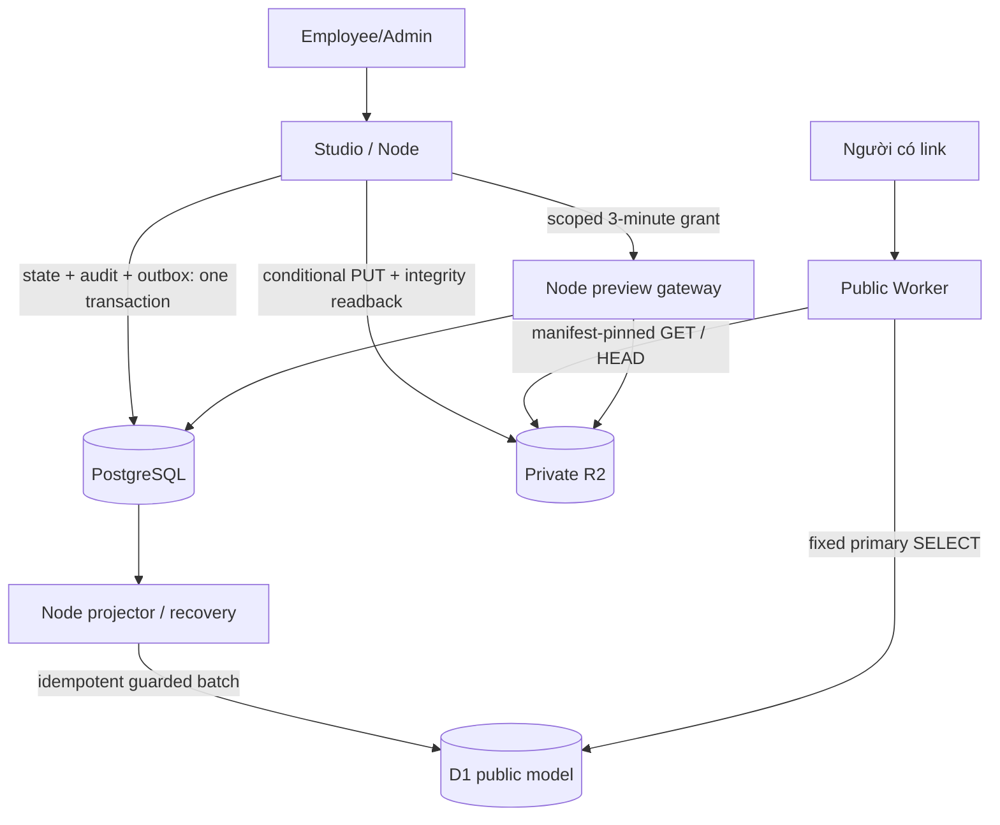

# Kiến trúc A' hiện hành

Loại tài liệu: mô tả code đã merge; reviewed main `3c965b5`. [ADR-0006](adr/0006-postgresql-source-of-truth-d1-public-read-model.md) là quyết định đích; [map](DOCUMENTATION_MAP.md) chỉ rõ provenance và lịch sử.

## Các đường dữ liệu

1. Employee/Admin → Studio/Node → Clerk/session + PostgreSQL allowlist/RBAC/ownership. Không quyền nào đến từ role client tự gửi.
2. Upload → validate ZIP/quota/path/active formats → reserve immutable version → conditional R2 PUT + size/SHA/ETag readback → PG activation/audit/outbox cùng transaction. Cleanup chỉ confirmed new keys; unknown PUT/COMMIT giữ lại để reconcile.
3. Node projector/recovery → ordered outbox → một guarded D1 batch/event. Projection_version tăng, tombstone không bị replay làm sống lại; không REST D1 trong handler.
4. Public request → một Worker → fixed primary SELECT theo code/statuspublished → asset đúng manifest từ private R2. Không Nodecallback/Clerk/admin secret/write API.
5. Private preview → Node/VM gateway → hash-only grant + actor/policy/version/expiry + private R2. Không qua public Worker.

## Route và origin

| Bề mặt | Hành vi |
| --- | --- |
| Studio `studio-lab.ods.vn` | UI và Node API same-origin, Clerk chỉ ở trusted Studio |
| Worker `/<code>` | Published lookup rồi 308 tới `/<code>/` |
| Worker `/<code>/` / `/<code>/<asset>` | HTML trực tiếp/asset trong immutable manifest. Public HTML có HTTP sandbox và frame-ancestors none, không dùng iframe shell |
| `/raw/<id>` hoặc shell OG | Chưa có; không tự suy từ đề xuất thành code |
| Node preview `p-<32hex>--<26base32>.lab-space-ods.cfvn.cloud` | Label 62,128-bitgrant/TTL 3 phút, scope actor/site/version; HTTP sandbox và Studio-onlyframe ancestor |
| Node `/view`, public gateway aliases | Không phải public serving path A' |
| `view-lab.ods.vn`/old 4100 | Runtime lab cũ được owner giữ, không là nguồn/fallback của A' |

Public/Studio khác registrable domain kể cả private PSLsuffix. Uploaded code không chạy trên server hoặc truy cập cookie/storage quản trị. Preview iframe không allow-same-origin; mọi direct/nested HTML vẫn có HTTP sandbox. Không thay domain production theo tài liệu này.

## Source of truth và nhất quán

PostgreSQL chứa user/policy/site/version/link/audit/receipt; D1 chỉ các trường public của [contract](D1_PUBLIC_READ_MODEL.md), không identity/session/title-description cho shell OG. R2 keys `<site>/<version>/<path>` bất biến, manifest pin size/ETag; Worker không rehash toàn file mỗi request.

Public path rechecks trạng thái và manifest mỗi request, no-store/nosniff/no-referrer, không cachequyền/304/range bypass. Revoke/unpublish/rotate chặn theo code sau projection, không chỉ chặn viewer như lab cũ. Byte đã tải trong tab không thu hồi được.

Native D1/R2 bindings có API ghi; code/test/review/gate deploy đảm bảo publicreader chỉ dùng fixed SELECT/get/head. Đây không là IAM read-only. Node projector token ở secret store riêng; Node web/preview không có D1 credential.

## Vận hành và bằng chứng

Healthy revoke p95≤60 s, warningpending>60 s; outage tách riêng, không 60 s blocking guarantee. Studio là kênh cảnh báo owner chọn, không closed-tab/VM-down delivery promise. [Acceptance](PILOT_APRIME_ACCEPTANCE.md) tách local/CI/actual/owner-confirmed/omitted/unverified.

Dùng [Node runbook](PILOT_APRIME_NODE_ROLLOUT.md), [projector](PUBLIC_PROJECTOR.md), [recovery](READ_MODEL_RECOVERY.md). Không khởi tạo lại volume/ledger hay apply lại 0004/0005. Authority ở [ma trận](PILOT_APRIME_AUTHORITY.md), không lấy từ một command trong snapshot cũ.
