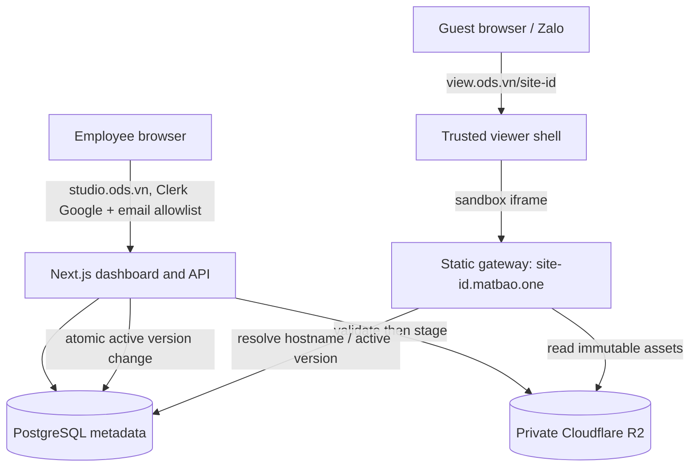

# Kiến trúc và luồng dữ liệu (đề xuất)

Trạng thái: **Proposed**. Triển khai thực tế phải đối chiếu với [ADR-0001](adr/0001-public-site-origin-isolation.md).

## Data model dự kiến

- `users`: id, external_identity, role, status, created_at.
- `sites`: id (unguessable), owner_id, display_name, status, active_version_id, created_at, updated_at.
- `site_versions`: id, site_id, storage_prefix, uploaded_by, manifest_hash, created_at, published_at.
- `audit_events`: actor_id, action, target_type, target_id, timestamp, request_id.

Site ID xuất hiện trong hostname public; dùng giá trị random đủ entropy (ít nhất 128 bits). ID không đại diện cho quyền truy cập bí mật.

## Branded link và cách sinh hostname

- `studio.ods.vn`: Next.js dashboard, Clerk Google Development (P2), API Route Handlers `/api/*` chung container. Danh sách email được phép, role Employee/Admin phải kiểm tra **trên server**. PostgreSQL và gateway kết nối bằng Docker internal network, chưa cần `api.ods.vn`.
- Link gửi khách: `https://view.ods.vn/<site-id>` trả **trusted viewer shell** (title, mô tả Open Graph và iframe responsive), tuyệt đối không trả raw HTML đã upload. Viewer không dùng cookie/session quản trị, không nhúng HTML untrusted vào DOM hoặc SSR. Có thể redirect `studio.ods.vn/view/<site-id>` về viewer, không render ở studio.
- Origin HTML: `https://<site-id>.matbao.one/`. Site ID do server sinh ngẫu nhiên >=128 bit, chỉ chứa ký tự DNS hợp lệ; reserve các hostname đã sử dụng và tên hệ thống (`www`, `mail`, `api`, `admin`, v.v.). Gateway đọc HTTP Host, so khớp chính xác ID hợp lệ trong database và trạng thái `published`, từ chối host không có site (404), chỉ lấy assets từ R2 **private**. Tạo site **không cần API tạo thêm DNS record**.
- P4 tạo **một** wildcard DNS record `*.matbao.one` trỏ tới reverse proxy/static gateway (Cloudflare Proxied); named DNS records cụ thể có ưu tiên trước wildcard nên các website đã có record riêng vẫn resolve tới đích cũ. Tuy vậy wildcard bắt mọi hostname chưa có record; phải kiểm kê DNS/Workers routes/hostname của zone trước thay đổi, không ghi đè record đang tồn tại, không cấp mã site trùng tên reserved, thử regression trên website hiện hữu. Wildcard route chỉ serve site ID hợp lệ.
- Cloudflare Universal SSL trên zone full setup thường bao phủ `*.matbao.one` (một cấp). Subdomain sâu kiểu `*.sites.matbao.one` cần cấu hình certificate bổ sung; vì vậy dùng một cấp cho MVP. Trình duyệt dùng Edge TLS, Cloudflare→VPS dùng Origin CA với Full (strict). Chưa tạo DNS, certificate hoặc route thật tại P0.
- **Cookie boundary:** `matbao.one` có thể chứa website khác do owner sở hữu. Nếu JS untrusted chạy trực tiếp ở `a.matbao.one`, nó có thể đặt cookie `Domain=matbao.one` ảnh hưởng các site khác trong domain này; wildcard DNS **không** giải quyết vấn đề cookie. Do đó gateway phải gửi HTTP header `Content-Security-Policy: sandbox allow-scripts` cho **mọi phản hồi HTML** upload (không chỉ `index.html`), **kể cả khi truy cập URL trực tiếp**, không cấp `allow-same-origin` hoặc khả năng thoát sandbox. Cấm upload/serve trực tiếp các định dạng có khả năng chạy script ngoài HTML đã sandbox (ví dụ SVG, XHTML, XML chủ động, PDF nhúng); chỉ thêm khi có threat review và response policy chặt chẽ. Viewer cũng dùng iframe `sandbox="allow-scripts"`, CSP `frame-src https://*.matbao.one`; gateway giới hạn `frame-ancestors https://view.ods.vn` và không cấp cookie/session quản trị. Kiểm chứng bằng browser rằng HTML trực tiếp/iframe không đặt/đọc được cookie hoặc storage trong cả domain; trước khi chứng minh, **không mở public gateway**.
- CSP sandbox tạo opaque origin; localStorage/service workers, ES modules, fetch/CORS, form, popup, top navigation và một số SPA/Web APIs sẽ bị hạn chế. P4 phải kiểm thử các gói HTML đại diện trên Chrome/Safari/Zalo trước khi cam kết hỗ trợ. Không gỡ `sandbox`/thêm `allow-same-origin` chỉ để sửa demo; thay đổi đó cần phương án cô lập khác (ví dụ domain chuyên dụng hoặc PSL được kiểm chứng) và security review riêng.
- Preview chưa published phải dùng grant phạm vi hẹp, TTL ngắn, không lộ token qua logs/referrer. Link published có thể được mọi người có URL truy cập; mã ID không thay thế xác thực nội dung bí mật.

## Upload & publish

1. Xác thực Employee và rate limit. Stream upload tới vùng tạm với byte cap.
2. Đối với file HTML: chuẩn hóa tên thành `index.html`. Đối với ZIP: chỉ hỗ trợ site có `index.html` tại root; từ chối absolute path, `..`, symlink, hardlink, encrypted archive, path trùng sau chuẩn hóa, file vượt size/count/depth và content không thuộc allowlist.
3. Kiểm tra tất cả entry trên stream trước khi publish, kiểm tra file extension/MIME, lập manifest; loại bỏ file server-executable. Không thực thi hoặc render HTML trên API host.
4. Ghi tệp vào storage key bất biến theo `siteId/versionId/path`. Chỉ sau khi upload thành công toàn bộ mới lưu version hoàn tất và đổi `active_version_id` trong transaction.
5. Nếu upload thất bại: không đổi phiên bản active; dọn staging bằng cleanup job.
6. Preview trên origin publish của phiên bản staging (grant ngắn hạn để không public trước publish), nhúng trong trusted viewer shell. Không inject nội dung vào dashboard DOM.

## Serving

- Resolve Host với allowlist domain publish và cú pháp ID nghiêm ngặt; không proxy tùy ý theo host.
- Tra status và active_version. `unpublished/deleted` trả 404 hoặc 410 theo chính sách.
- Chỉ serve các asset đã ghi trong manifest; ngăn traversal/encoded path, enforce `Content-Type`, `nosniff`, HTTPS, limits, cache headers. Mọi `.html`/`.htm` phải nhận CSP `sandbox` ở HTTP response, kể cả trang phụ hoặc khi mở trực tiếp; từ chối các active content types chưa được sandbox/review. Response của gateway không có session cookie/credential của admin.
- Bản tài nguyên dùng content hash/immutable version key; HTML entrypoint có cache ngắn/no-cache để việc update/unpublish có hiệu lực nhanh; CDN cache invalidation nếu dùng.
- Tên site và tài nguyên tương đối chạy ở root riêng của site (`https://<id>.matbao.one/`), tránh lỗi khi asset dùng URL bắt đầu bằng `/`.
- Content Security Policy nên bảo vệ người xem, nhưng phải test với các script/worker/CDN được hỗ trợ; không hứa chạy mọi Web API trong Zalo.
- DNS wildcard và TLS phải bao phủ publish host trước khi beta; không chia sẻ cookies giữa admin và public.

## Vận hành

Lab dùng Docker Compose trên máy hiện tại; production ban đầu VPS/Docker Compose. Secrets qua environment/secret store, không commit. Cloudflare R2 private với IAM tối thiểu chỉ gateway/API được truy cập; MinIO legacy chỉ local P1. Theo owner, **không triển khai backup/restore trong MVP**, chấp nhận rủi ro mất dữ liệu vĩnh viễn. Retention cấu hình được (khởi đầu tối đa 10 version cũ/site, soft-delete 30 ngày, staging cleanup 24 giờ), không xóa active version. Event logs không chứa file HTML hoặc thông tin nhạy cảm. Giới hạn ZIP 20 MiB nén / 100 MiB giải nén / 500 file / depth 12; có quota/rate limit và giám sát. Nội dung upload có thể chứa phishing/tracking; cần quy trình gỡ bỏ/báo cáo trước production.

## Kiểm thử trọng tâm

- ZIP traversal, absolute path, symlink, duplicate path, decompression bomb, wrong MIME, upload interrupted.
- Guest không dùng endpoint quản trị; Employee không tác động site người khác; Admin access audit.
- Cross-origin: cookies/localStorage/service worker không vượt từ publish site sang admin hoặc site khác.
- Với các hostname hiện hữu trên `matbao.one`, test không bị wildcard DNS/routing chiếm đường và không bị cookie parent-domain do site upload đặt. Kiểm chứng CSP sandbox HTTP header ở cả direct navigation và iframe viewer; các script không được đọc/ghi cookies/storage, popups, top navigation. Test assets root/relative, modules/fetch/CORS, Open Graph trong Zalo, browser/mobile tương thích.
- Hot update không serve tài nguyên nửa chừng; unpublish có hiệu lực theo TTL đã công bố.
- Chrome/Firefox/Safari + mobile Chrome/Safari, Zalo in-app browser; ghi lại browser/API bị giới hạn.
