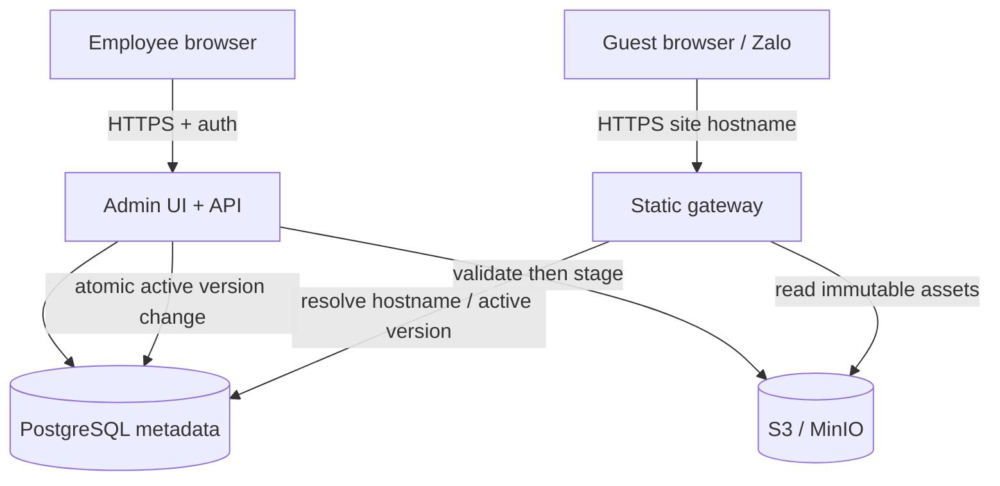

# Kiến trúc và luồng dữ liệu (đề xuất)

Trạng thái: **Proposed**. Triển khai thực tế phải đối chiếu với [ADR-0001](adr/0001-public-site-origin-isolation.md).

## Data model dự kiến

- `users`: id, external_identity, role, status, created_at.
- `sites`: id (unguessable), owner_id, display_name, status, active_version_id, created_at, updated_at.
- `site_versions`: id, site_id, storage_prefix, uploaded_by, manifest_hash, created_at, published_at.
- `audit_events`: actor_id, action, target_type, target_id, timestamp, request_id.

Site ID xuất hiện trong hostname public; dùng giá trị random đủ entropy (ít nhất 128 bits). ID không đại diện cho quyền truy cập bí mật.

## Upload & publish

1. Xác thực Employee và rate limit. Stream upload tới vùng tạm với byte cap.
2. Đối với file HTML: chuẩn hóa tên thành `index.html`. Đối với ZIP: chỉ hỗ trợ site có `index.html` tại root; từ chối absolute path, `..`, symlink, hardlink, encrypted archive, path trùng sau chuẩn hóa, file vượt size/count/depth và content không thuộc allowlist.
3. Kiểm tra tất cả entry trên stream trước khi publish, kiểm tra file extension/MIME, lập manifest; loại bỏ file server-executable. Không thực thi hoặc render HTML trên API host.
4. Ghi tệp vào storage key bất biến theo `siteId/versionId/path`. Chỉ sau khi upload thành công toàn bộ mới lưu version hoàn tất và đổi `active_version_id` trong transaction.
5. Nếu upload thất bại: không đổi phiên bản active; dọn staging bằng cleanup job.
6. Preview trên origin publish của phiên bản staging (quyền truy cập token ngắn hạn để không public trước publish). Không inject nội dung vào dashboard DOM.

## Serving

- Resolve Host với allowlist domain publish và cú pháp ID nghiêm ngặt; không proxy tùy ý theo host.
- Tra status và active_version. `unpublished/deleted` trả 404 hoặc 410 theo chính sách.
- Chỉ serve các asset đã ghi trong manifest; ngăn traversal/encoded path, enforce `Content-Type`, `nosniff`, HTTPS, limits, cache headers. Response của gateway không có session cookie/credential của admin.
- Bản tài nguyên dùng content hash/immutable version key; HTML entrypoint có cache ngắn/no-cache để việc update/unpublish có hiệu lực nhanh; CDN cache invalidation nếu dùng.
- Tên site và tài nguyên tương đối chạy ở root riêng của site (`https://<id>.pages-example.net/`), tránh lỗi khi asset dùng URL bắt đầu bằng `/`.
- Content Security Policy nên bảo vệ người xem, nhưng phải test với các script/worker/CDN được hỗ trợ; không hứa chạy mọi Web API trong Zalo.
- DNS wildcard và TLS phải bao phủ publish host trước khi beta; không chia sẻ cookies giữa admin và public.

## Vận hành

Secrets qua environment/secret store, không commit. Object storage private với IAM chỉ gateway/API được truy cập. Backup Postgres và bucket theo lịch; thử restore trên staging. Event logs không chứa file HTML hoặc thông tin nhạy cảm. Thiết lập quota/rate limits, giám sát số file, dung lượng, lỗi serving, login và cập nhật version. Nội dung người dùng tải lên là untrusted và có thể chứa phishing, external tracking; cần cơ chế báo cáo/gỡ nội dung trước production.

## Kiểm thử trọng tâm

- ZIP traversal, absolute path, symlink, duplicate path, decompression bomb, wrong MIME, upload interrupted.
- Guest không dùng endpoint quản trị; Employee không tác động site người khác; Admin access audit.
- Cross-origin: cookies/localStorage/service worker không vượt từ publish site sang admin hoặc site khác.
- Hot update không serve tài nguyên nửa chừng; unpublish có hiệu lực theo TTL đã công bố.
- Chrome/Firefox/Safari + mobile Chrome/Safari, Zalo in-app browser; ghi lại browser/API bị giới hạn.
